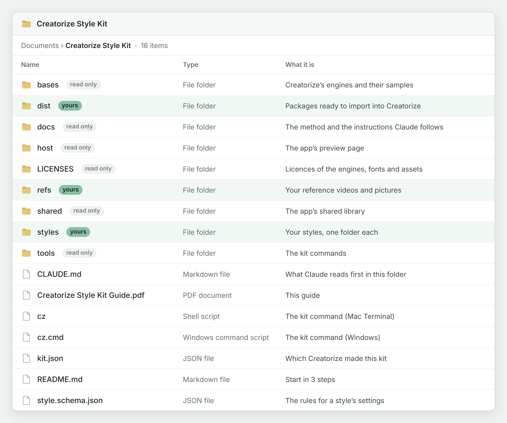
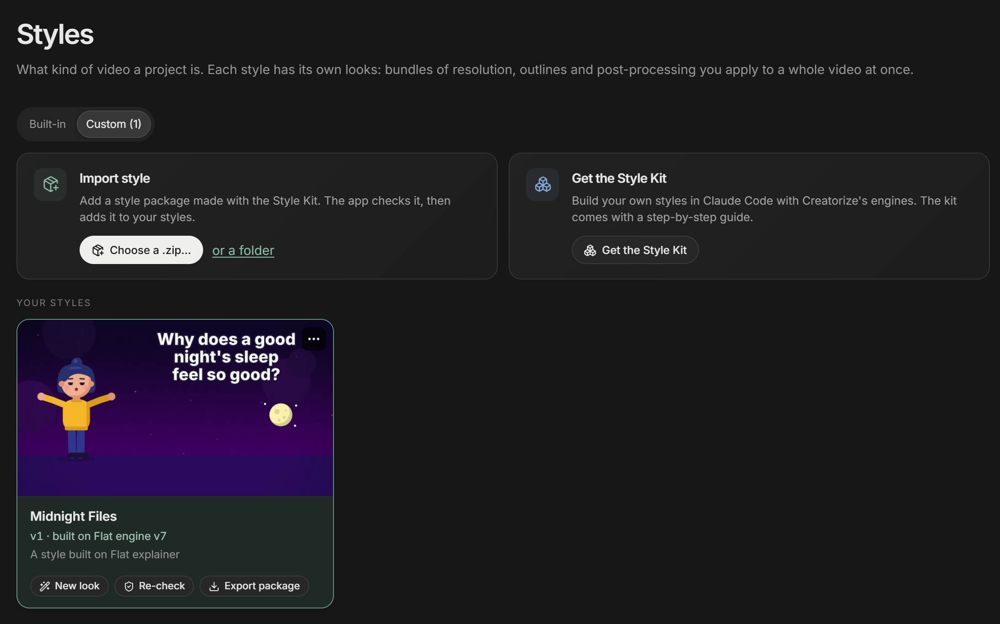
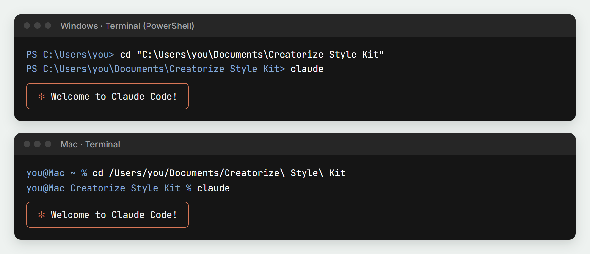
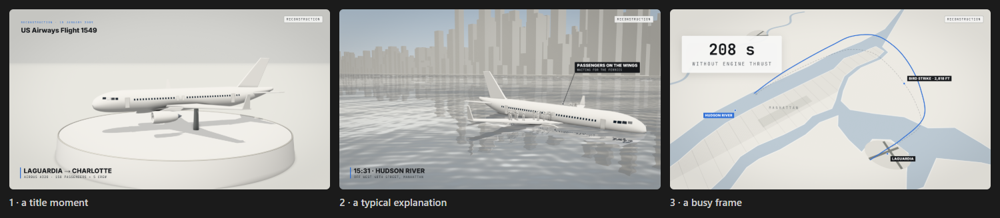
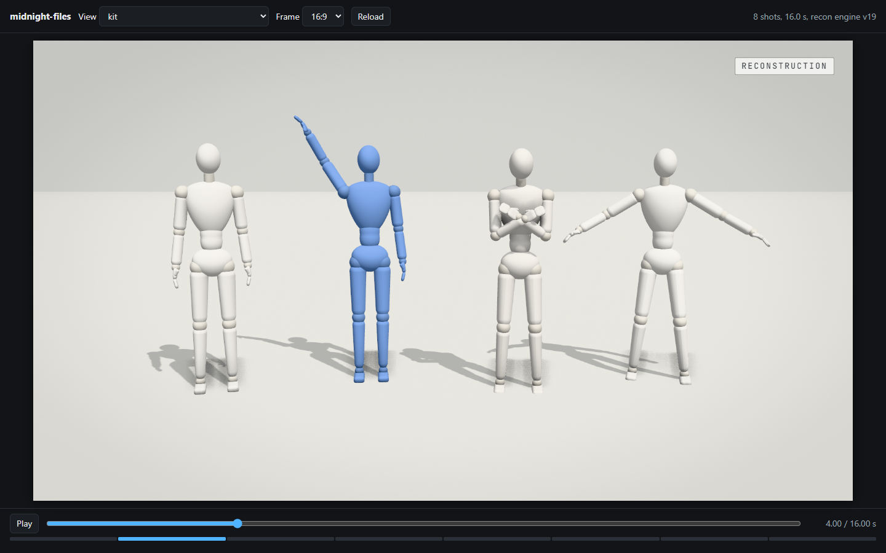
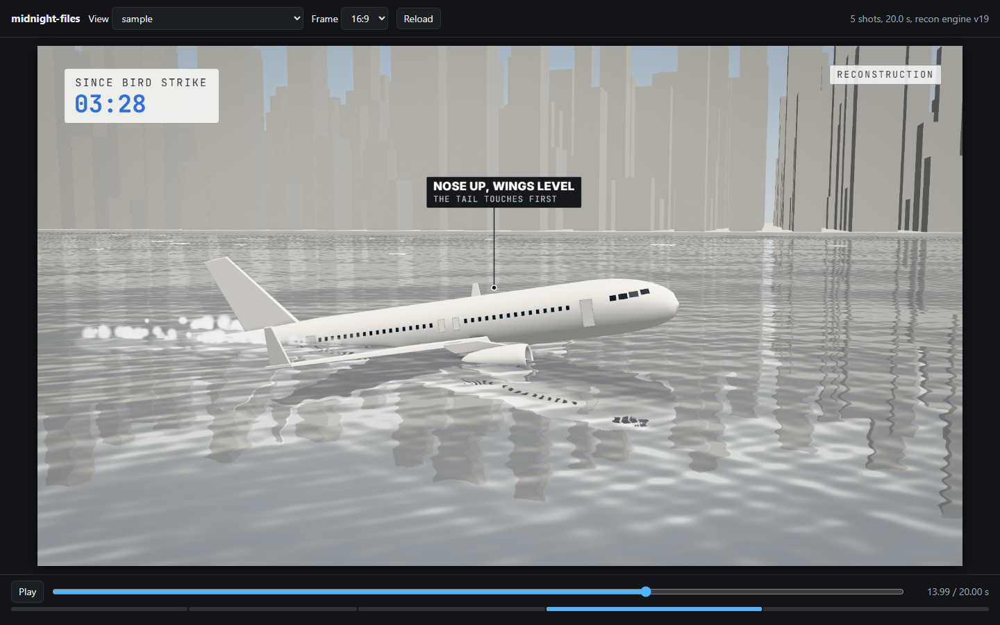
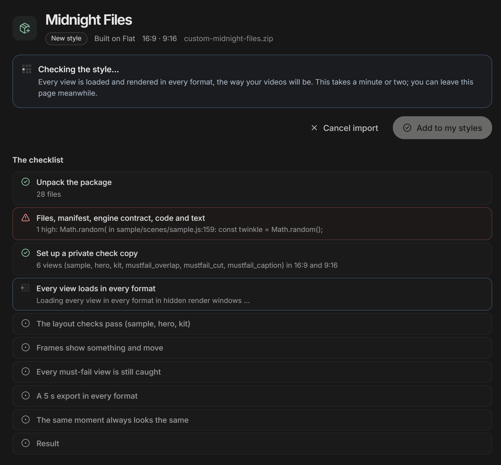
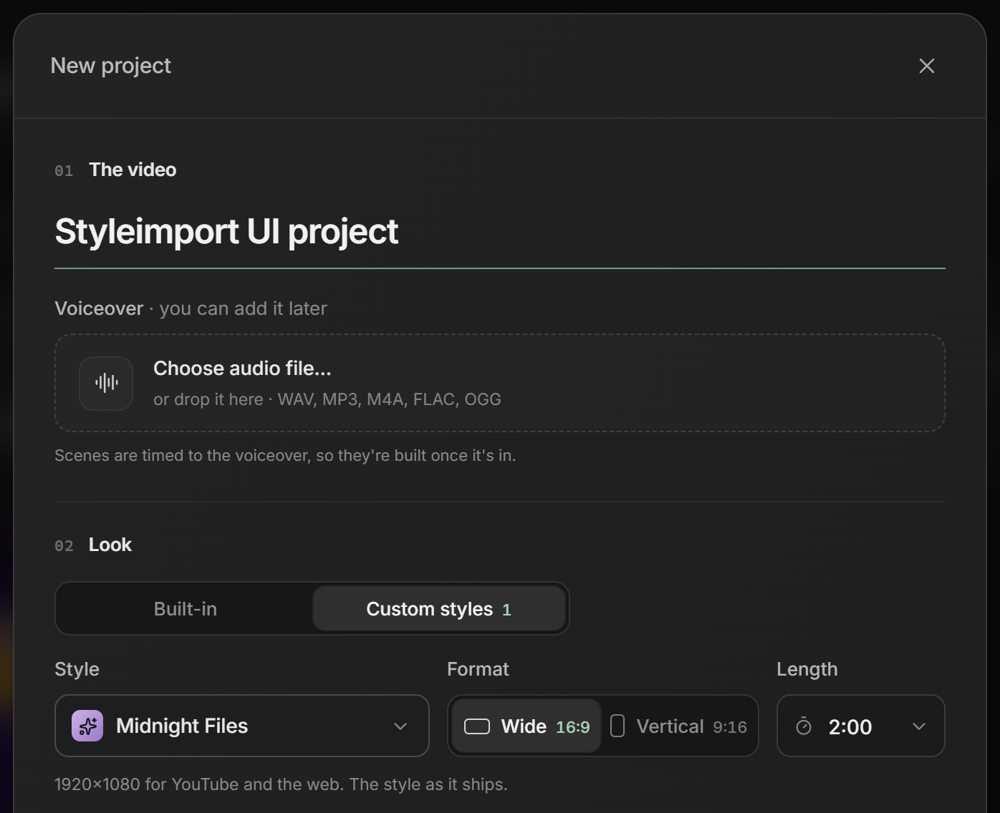

# Creatorize Style Kit: the guide

Build your own video style with Claude Code, on the same engines Creatorize uses, and add it to Creatorize so every
video, routine and look can use it.

---

## 1. What the kit is, and why

The Style Kit is a folder on your computer. Inside it are Creatorize's real video engines (the same ones the app renders
with), the checks the app runs, and instructions that turn Claude Code into a style developer. You talk to Claude in plain
words ("make a style like these videos"), Claude builds the style step by step and shows you frames to approve, and at the
end it packs the style into one file. You import that file into Creatorize, the app checks it again, and the style appears
next to the built-in ones.

Why it works this way:
- **You get the best results where Claude works best:** in Claude Code, with time to study your references, try things
  and check every frame.
- **The engines are the real ones.** What you see in the kit is what Creatorize renders. Nothing has to be "translated"
  later.
- **The app checks everything again** when you import, with the same checks, so a style that passes in the kit passes in
  the app.
- **Your videos are safe.** A style never changes on its own, and videos keep the style version they were made with.



## 2. What you need

- **Creatorize installed and signed in, on Premium.** Custom styles are a Premium feature.
- **Claude Code** (Creatorize's installer already installed it). To check, open PowerShell (Windows) or Terminal (Mac)
  and type `claude --version`.
- **Google Chrome or Microsoft Edge.** Windows always has Edge. On a Mac, install Chrome if you don't have it.
- **ffmpeg, git and Node.js** come with Creatorize's installer. You don't install anything else.
- Optional: 1-3 reference videos or pictures of the look you want.

## 3. Get the kit

1. Open Creatorize and go to **Styles**, then the **Custom** tab.
2. Click **Get the Style Kit**.
3. Pick a folder, for example your Documents folder. Creatorize creates a folder called **Creatorize Style Kit** there,
   shows it to you and opens this guide.

The kit always matches your Creatorize version. After an app update, getting the kit again into the same folder
refreshes the engines and keeps your styles (section 12).



Put your reference videos and pictures into the kit's **refs** folder (create it inside the kit folder if it isn't
there). They stay on your computer: they are never put into a style package.

## 4. Start Claude Code in the kit folder

**Windows**
1. In File Explorer, right-click the **Creatorize Style Kit** folder and choose **Copy as path** (on Windows 10, hold
   Shift while you right-click).
2. Open **Terminal** (or **PowerShell**) from the Start menu.
3. Type `cd ` (with a space after it), paste the path with a right-click or Ctrl+V, and press Enter. It looks like:
   ```
   cd "C:\Users\you\Documents\Creatorize Style Kit"
   ```
4. Type `claude` and press Enter.

**Mac**
1. Open **Terminal** (press Cmd+Space, type Terminal, press Return).
2. Type `cd ` (with a space after it), then drag the **Creatorize Style Kit** folder from Finder onto the Terminal window.
   The path appears (the backslashes before the spaces are right). Press Return. It looks like:
   ```
   cd /Users/you/Documents/Creatorize\ Style\ Kit
   ```
3. Type `claude` and press Return.

The first time, Claude Code asks whether you trust the files in this folder: say yes (it is your kit). When Claude wants
to run a kit command (they start with `cz`) or ffmpeg, it asks first; allowing them saves you a lot of clicks.

Claude now knows the kit: the instructions in the folder load by themselves.

The first thing Claude runs is `cz doctor`: a one-minute check of this computer. It finds Chrome or Edge (the kit draws
your style in it, out of sight), ffmpeg (makes the videos) and your Creatorize app (the kit borrows its fonts and model
library), and says in plain words if something is missing. If it reports a problem, section 13 says what to do.



## 5. Your first style in 30-60 minutes

In the first 30-60 minutes you see your style's first frames and steer it. Finishing it (every element, the sample
video, all the checks) takes Claude a few more hours, mostly on its own, with you approving at four points. Here is a
whole run with the exact words to type. Change the name, base and formats to yours.

**1. Ask for the style.**
```
Study the videos in refs/ and make a style called Midnight Files on the recon base, 16:9 and 9:16.
```
Not sure which base? Leave it out ("make a style like the videos in refs/") and Claude suggests two with a reason each.
The bases: **starter** (2D or 3D, for anything new), **flat** (flat cartoon explainers with a character), **collage**
(paper cut-outs and pictures), **recon** (3D documentaries of real events), **lowpoly** (game-style 3D shorts),
**pixel-art** (retro 3D) and **stickman** (MS Paint stick figures).

Claude may ask you a few things first: what your videos are about, how long they are, who appears in them.

**2. Claude studies your references** (10-20 minutes). It measures them: colours as exact values, how long shots are, how
fast the narration is, how things move. You don't need to do anything.

**3. You approve three hero frames.** Claude writes the style's rules and shows you three still frames: a title moment, a
typical explanation, a busy frame. This is the moment to steer. Say exactly what you see and want:
```
Good direction. The background should be darker, like the reference at 0:12. Titles 20% bigger. Then build the kit.
```



**4. You approve the kit.** Claude builds every element the style needs (cards, labels, tags, props, transitions) and
shows each one alone in a gallery that plays in a window. Approve or flag elements by name:
```
The red tag is too loud: use the dark grey version. Everything else is approved.
```



**5. You watch the sample.** Claude makes a 15-30 second sample video in your style, in every format you chose, timed to
a sample narration. Watch it like a viewer would.

**6. Claude reviews and checks.** Claude runs the checks, looks at every shot frame by frame, fixes what it finds, and
every few rounds asks a fresh "critic" (a second Claude that only looks) to judge it. You can say:
```
Run the review until it's clean, then sign off.
```

**7. Package it.**
```
Package it.
```
Claude makes the file to import (section 9).

## 6. How to look at your style

The easiest way: ask Claude ("show me the sample", "show me the kit"). It opens a window that plays the style on the
same page Creatorize renders with.

You can also type the kit commands yourself in a second Terminal / PowerShell window in the kit folder. `midnight-files`
is the style's folder name (in `styles/`):

| What | Windows (PowerShell) | Mac (Terminal) |
|---|---|---|
| Play the sample | `.\cz preview midnight-files sample` | `./cz preview midnight-files sample` |
| Play the kit gallery | `.\cz preview midnight-files kit` | `./cz preview midnight-files kit` |
| Make still frames at 1 s and 3.5 s, tall format | `.\cz stills midnight-files sample --times 1,3.5 --aspect 9:16` | `./cz stills midnight-files sample --times 1,3.5 --aspect 9:16` |
| List your styles | `.\cz list` | `./cz list` |

The preview keeps running while you watch; press Ctrl+C in that window to stop it (on a Mac too). In the old Command
Prompt on Windows, `cz` works without `.\` in front.

Give it a moment: a preview opens in 10-30 seconds, a full check (`cz check`) takes about 1-3 minutes depending on the
base (3D reconstruction is the slowest), and still frames come in a few seconds each.



## 7. How to iterate

**Say what, where and when.** Claude fixes faster when you name the moment:
```
At 4.2 s in the 9:16 sample, the title touches the right edge.
```
```
In the kit, the "Source" card's text is hard to read on the dark background.
```
You can also drag an image file (a screenshot, a frame) into the Claude Code window: its path is added to your message.

**Ask for checks:**
```
Run the checks and fix what they find.
```

**Ask for a fresh look:**
```
Do three review rounds, then have a fresh critic compare it with the references.
```

**Save points.** Claude makes a save point after every approved step. To go back:
```
Go back to the save point before the font change.
```
Every package you import also becomes a version in Creatorize (v1, v2, ...), and the app keeps your last versions
(section 11).

**Big change of direction?** Say so plainly ("I want it lighter overall, more like refs/b.mp4"). Claude goes back to the
style guide and the hero frames and redoes the later steps in order. That costs time, so it is best decided at the hero
frames.

## 8. Bringing an existing setup

Already making videos with your own Claude Code setup (HyperFrames, Remotion, a Three.js page, Python and ffmpeg, After
Effects templates, a template folder plus a build folder)? The look comes over; the code doesn't. Creatorize renders every
style on its own engines, so Claude measures your setup and rebuilds the look on the closest base.

1. Copy your old setup into the kit folder, for example into a folder called `old`, and put 1-3 of your finished videos
   into `refs`.
2. Type:
   ```
   Bring my setup in old/ over as a style called Night Shift. My finished videos are in refs/.
   ```
3. Claude lists what makes your look (colours, fonts, layout, motion, transitions, characters, captions, pacing), picks
   the closest base and tells you why, and rebuilds the first 15 seconds of one of your videos side by side with the
   original, so you can compare frame by frame.
4. When you are happy with the match, it continues with the normal steps (kit, sample, checks, package).

What comes over: your look (colours, type, layout, motion feel, transitions, pacing), your own drawings, characters and
logos, fonts and assets whose licences allow it. What doesn't: the old code itself, anything that loads from the internet
while rendering, and effects no Creatorize engine can draw (Claude tells you which, and shows the closest result).

## 9. Export and import

**1. Package.** Ask Claude to "package it". The file lands in the kit's `dist` folder, named like
`custom-midnight-files.zip`.

**2. Import.** In Creatorize: **Styles > Custom > Import style**, and pick that file.



**3. The checklist.** Creatorize checks the style in two parts:
- **The files:** the style's settings are valid, nothing too big or not allowed is inside, the engine still has
  everything the app needs, the code gives the same picture every time, the sample is complete, the looks are valid,
  the texts are filled in, every asset has a credit, every font has its licence.
- **The pictures:** every part of the style is rendered in every format: it must load without errors, pass the layout
  checks (nothing cut off, overlapping or unreadable), never show a blank or frozen shot, export a short video, give the
  same frame every time, and its "must-fail" scenes must still fail (proof the checks work).

Each problem is shown in three parts: **what was found -> what it means -> how to fix it**.

**4. If something fails**, you have two choices:
- **Let Claude fix it:** a Claude inside Creatorize fixes it. It can only change this style's files (never the app, never
  other styles, never your videos), and Creatorize re-checks everything itself after each round (up to 3 rounds).
- **Copy fix list:** copies the problems as text. Paste it into Claude Code in the kit:
  ```
  The app said these failed: (paste here)
  ```
  Claude fixes them in the kit and packages again. Then import again.

If you used **Let Claude fix it**, bring those fixes back into the kit before you change anything else: on the style's
card click **Export package**, then tell Claude in the kit
`Bring this package back: C:\Users\you\Downloads\custom-midnight-files.zip` (on Mac, the Mac path). Otherwise your next
package would undo the app's fixes.

**5. Add to my styles.** When everything is green, click it. The style appears everywhere at once.

## 10. Using your style

- **New project:** above the style picker, switch from **Built-in** to **Custom styles**. Your style's card shows its
  version (v1). Pick it and the format (if it has both), and continue as usual.



- **Routines:** pick your style in the routine's style setting, like any built-in style.
- **Looks:** a look is a set of settings for a style (colours, grain, camera, captions). Make one from the style's card
  (**New look**) or change the settings of one video in its Look panel.
- **The style's card** (Styles > Custom) shows "vN · built on <Base> engine vM", and has Re-check, Export package, Show
  folder and Delete. Delete is refused while videos use the style (it lists them).

## 11. Updating your style

1. Change the style in the kit with Claude, then package it again.
2. **Import style** again with the new file. Because it is the same style, it becomes the next version: **v2**.
3. Your existing videos keep the version they were made with. In a video made with v1, the editor shows
   **"Midnight Files v2 is available · Update"**. Update when you want it; it is one step in the video's History, so you
   can undo it.
4. Creatorize keeps your last 3 versions. To return to an older one, use **Go back to v1** on the style's card: it is
   installed again as the next version (v3), so nothing is lost.

New videos always start on the newest version.

## 12. When Creatorize updates its engines

Creatorize improves its built-in engines over time. **Your style keeps the engine it was built on** and keeps working
exactly as before: app updates never change it.

When a newer engine is available, the style's card says **engine update available**. To move your style to it (only if
you want what the new engine brings):
1. **Styles > Custom > Get the Style Kit** again, and pick the **same folder**. The kit's engines, tools and instructions
   are refreshed; your `styles` and `dist` folders stay as they are.
2. Start Claude Code in the kit and type:
   ```
   Update Midnight Files to the new engine.
   ```
   Claude merges the new engine with your style's changes, runs every check, and compares frames from before and after
   so the look stays the same.
3. Package and import: it becomes the next version, and your videos get the Update offer as in section 11.

## 13. Troubleshooting

| You see | What to do |
|---|---|
| `'cz' is not recognized` (PowerShell) | Type `.\cz` instead of `cz` (PowerShell doesn't run files from the current folder without `.\`). |
| `zsh: permission denied: ./cz` (Mac) | Type `chmod +x cz` once in the kit folder, then try again. |
| `claude: command not found` / `'claude' is not recognized` | Close and reopen Terminal / PowerShell. Still missing: install Claude Code with the command below this table. |
| Claude says `cz doctor` found no browser | Install Google Chrome or Microsoft Edge (Windows always has Edge; on a Mac, install one of them). |
| Claude says ffmpeg is missing | Windows PowerShell: `winget install --id Gyan.FFmpeg -e`; Mac Terminal: `brew install ffmpeg`. Then reopen the terminal. |
| `cz doctor` says Creatorize moved or can't be found | Get the Style Kit again into the same folder (your styles stay). |
| The preview window stays blank | Ask Claude to run `cz doctor` and `cz check` on the style: the first error tells it what is missing. |
| There is no Import style or Get the Style Kit | Custom styles need Premium, and a Creatorize version with the Style Kit: update the app. |
| The import checklist shows red items | Click **Let Claude fix it**, or **Copy fix list** and paste it into Claude Code in the kit. |
| "Let Claude fix it" stopped with items still red | Copy fix list, paste into Claude Code in the kit; it has more room to fix bigger problems. |
| My style changes from the app are gone after a re-import | The app's fixes weren't brought back: Export package from the card, then "Bring this package back: <file>" in the kit (section 9). |
| Delete is refused | Videos still use the style; the message lists them. |
| A video looks different after Update | Undo it in the video's History, and tell Claude in the kit what changed. |
| Claude asks for permission for every command | Allow it for this folder when it offers "don't ask again". |

Installing Claude Code, if it is missing:
- Windows, in PowerShell: `irm https://claude.ai/install.ps1 | iex`
- Mac, in Terminal: `curl -fsSL https://claude.ai/install.sh | bash`

Then close and reopen the window and type `claude` again.

## 14. Rules

These protect you, your channel and other members.
- **The kit is for building styles for Creatorize** (TERMS.md in the kit folder). Its videos are short previews (at most
  30 seconds, with a "Creatorize Style Kit · preview" mark); your real videos are made in Creatorize. Don't share the kit
  itself; share the style packages you make with other members.
- **Licences.** Only assets you may hand on: CC0, public domain, CC-BY (with the author credited), free fonts with their
  licence (OFL), or your own work. Claude keeps a credits list (CREDITS.json) and the app checks it.
- **No Mixamo files in a style.** Mixamo characters and animations may be used in your own videos inside Creatorize (the
  app's character and animation import), never inside a style package.
- **Never your reference videos.** They stay in `refs` on your computer; packages only carry Claude's notes about them.
- **No secrets.** Never put API keys or passwords in the kit folder.
- **No slop** (the same rules as every Creatorize style): no red stamps or verdict words slapped on screen ("CLOSED",
  "DENIED"), no notice that the voice is AI, no sound effects you didn't supply, no text inside generated pictures, no
  drawn stand-ins for real evidence, and every frame readable.
- **Styles take the look of references, never their content:** no copied faces, logos, characters or artwork.

## 15. Glossary

| Word | Meaning |
|---|---|
| Base | One of Creatorize's engines a style is built on (starter, flat, collage, recon, lowpoly, pixel-art, stickman). |
| Engine | The code that draws the video. Your style has its own copy of its base's engine. |
| Style | A look plus its engine, rules and settings. Many videos can use one style. |
| Look | Saved settings for a style (colours, grain, camera, captions). One style can have many looks. |
| Format / aspect | 16:9 (wide, YouTube) or 9:16 (tall, Shorts). A style can do one or both. |
| Hero frames | Three still frames that show the style at its best; you approve them first. |
| Kit (of a style) | Every element of the style shown alone, so each can be judged and approved. |
| Sample | A 15-30 second video in the style, made from a sample narration. |
| Check | An automatic test of the style (it loads, nothing is cut off, text reads, the same frame every time ...). |
| Must-fail scene | A scene that is wrong on purpose. If its check stops catching it, the check is broken. |
| Finding | A problem a check or Claude found, written as what -> what it means -> how to fix it. |
| Critic | A fresh Claude that only looks and judges, every few review rounds. |
| Package | The one file (`.zip`) you import into Creatorize. |
| Version | Each import of the same style is a new version (v1, v2 ...). Videos keep theirs until you Update. |
| Rebase | Moving your style to a newer engine from Creatorize, keeping your changes. |
| Kit folder | The Creatorize Style Kit folder on your computer, where Claude Code works. |
